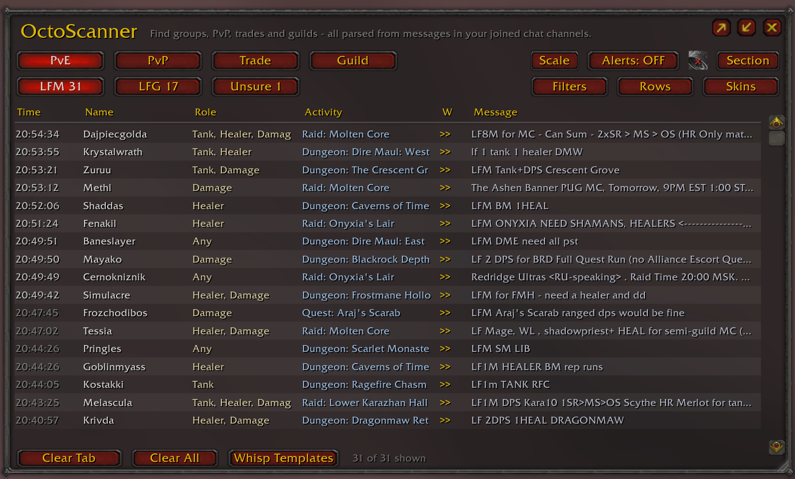
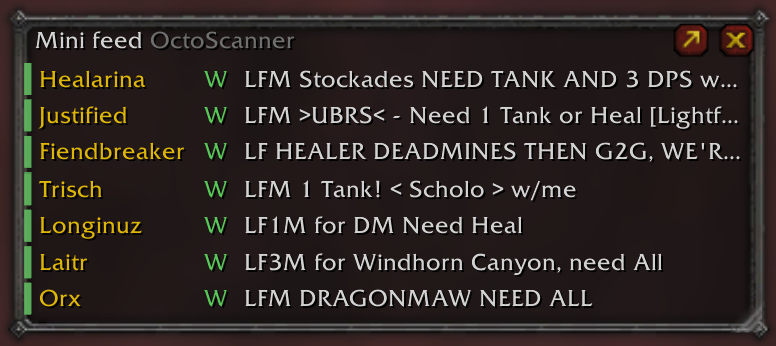
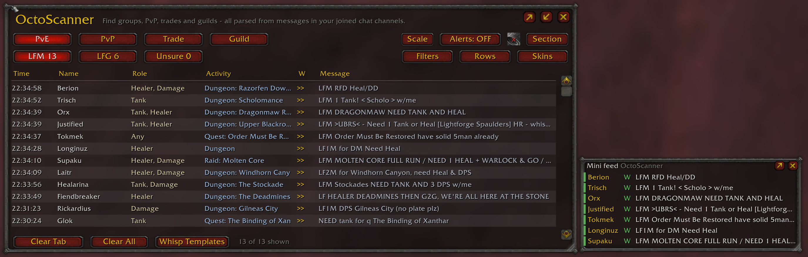
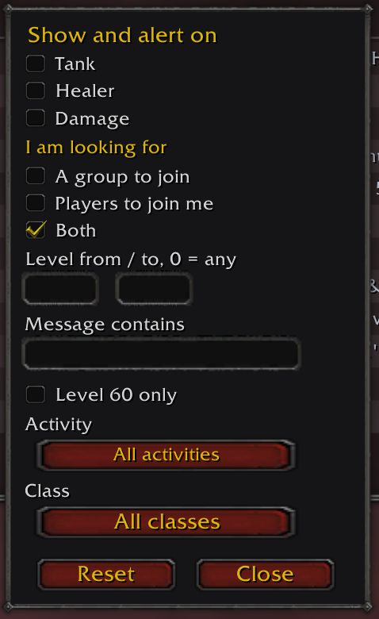
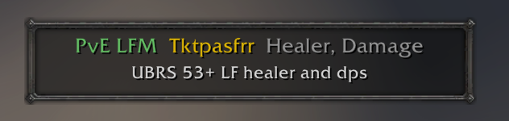
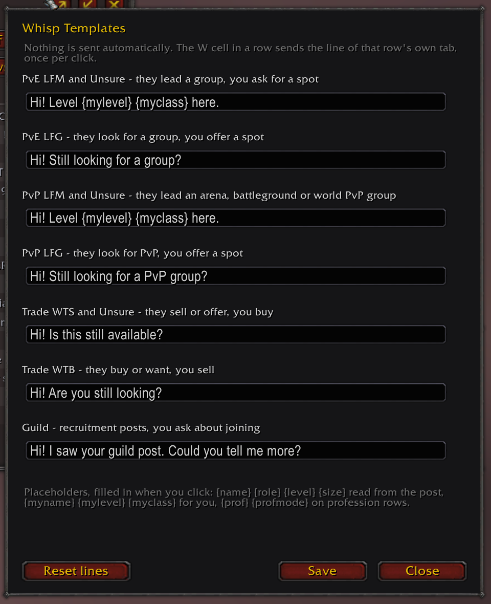

# OctoScanner

A chat scanner for **OctoWoW**. It reads messages in your joined chat channels and turns group, PvP, trade and guild adverts into a sortable, filterable table, with whisper and player actions from each row.

**Version 1.0.0** · Vanilla 1.12 addon API · Interface 11200 · Lua 5.0

**[Download source ZIP](https://github.com/Kropackova/OctoScanner/archive/refs/heads/main.zip)** · [Releases](https://github.com/Kropackova/OctoScanner/releases)



*The PvE LFM table, with roles, named activities and one-click whisper. Sections and tabs sit on the left; scale, filters, alerts, columns and skins sit on the right.*

## Installation

The addon folder must be named **OctoScanner**, with this exact layout:

```text
Interface\AddOns\OctoScanner\OctoScanner.toc
```

1. Download the source ZIP above, or an `OctoScanner-<version>-OctoWoW.zip` installer from **Assets** when one is available on the Releases page.
2. Close the game.
3. For the source ZIP, rename the extracted `OctoScanner-main` folder to `OctoScanner`. The installer already contains the correct folder name.
4. Copy that single folder into `Interface\AddOns`. Replace the existing addon files when upgrading.
5. Enable **OctoScanner** in the character selection screen's addon list, then open it with `/ocs` or the minimap button.

SuperWoW, Nampower and ClassicAPI are not required. Settings are saved per character in `OCS_DB` and survive an ordinary upgrade.

## Contents

- [Features](#features)
- [Quick start](#quick-start)
- [Sections and tabs](#sections-and-tabs)
- [Table and history](#table-and-history)
- [Rows](#rows)
- [Mini feed](#mini-feed)
- [Filters](#filters)
- [Alerts](#alerts)
- [Whispers](#whispers)
- [Scale and skins](#scale-and-skins)
- [Content profiles](#content-profiles)
- [Commands](#commands)
- [Troubleshooting](#troubleshooting)
- [Credits and license](#credits-and-license)
- [Changelog](CHANGELOG.md)

## Features

- **Four sections and ten tabs:** PvE, PvP, Trade and Guild, separated by what the sender is looking for.
- **Parsed adverts:** roles, classes, levels, group progress, dungeons, raids, world bosses, quest groups, battlegrounds and trade services.
- **Sortable table:** newest first by default, full-message tooltips and editable role, level and progress cells.
- **Filters per section:** activity, named instance, class, role, level and message text.
- **Alerts and mini feed:** matching adverts stay within reach while you play.
- **Seven whisper templates:** custom lines with placeholders, including your own class and level.
- **Resizable windows and columns:** saved positions, per-section column choices, seven skins and addon scale from 50% to 100%.

## Quick start

Join the channels you want to scan, open `/ocs`, choose a section and tab, then wait for adverts. Closing the window keeps scanning active. The addon reads chat your character receives; it does not join channels or query server listings.

Right-click a row for player actions, copying, removal or moving it to another tab. Click **W** to send that row's whisper template. Nothing is sent automatically.

## Sections and tabs

| Section | Tabs | Typical entries |
| --- | --- | --- |
| PvE | LFM, LFG, Unsure | Dungeons, raids, world bosses and quest groups |
| PvP | LFM, LFG, Unsure | Battleground queue calls, premades and arena groups |
| Trade | WTS, WTB, Unsure | Items, crafting, enchants, summons and services |
| Guild | Guild | Recruitment and players seeking a guild |

**Unsure** holds ambiguous requests. Ordinary conversation, recognized addon transport traffic and buff bot announcements are filtered. Explicit recruitment for an unknown activity remains a general Group entry.

Tab counts show matching/total records when filters hide some entries.

## Table and history

| Column | Content |
| --- | --- |
| Time | When the advert was received |
| Name | The sender |
| Role | Roles requested or offered |
| Class | Classes named in the advert |
| Activity | The activity and named dungeon, raid, boss or quest |
| Filled | Advertised group progress, such as 15/20 |
| Lvl | A character level or level range |
| W | Sends the template for that row's section and intent |
| Message | The advert; hover to read the full text |

Click a column heading to sort, then click again to reverse the order. Your sorting choice is saved. A player's next accepted advert updates their existing row and can move it to another tab. Manual cell edits stay locked until you restore the parsed value, including when a repeat advert changes tab.

Roles accept counts such as `3xDPS` and `heal1`. In a roster such as `2/2 tanks 1/3 healers 5/5 DPS`, only Healer is still needed. Minimum levels such as `53+` are kept separate from recruitment counts and raid sizes. Linked quest and item titles do not add roles or character levels.

**Rows remain throughout the current session without automatic age or count cleanup.** An old row can fade but stays available until updated or manually removed. At every addon load, including `/reload`, only records **younger than one hour** are restored. Logout also trims saved history to that period. Window positions and settings remain saved.

Use **Clear Tab**, **Clear All**, `/ocs clear`, `/ocs clearall` or the row menu to remove records manually. Clear All asks for confirmation.

The addon reads text. It cannot know whether a place is still open, who is actually in a group or what a sender intended when the advert is ambiguous.

## Rows

**Rows** chooses the columns shown in each section. PvE starts with **Class, Filled and Lvl hidden**; PvP starts with **Role and Lvl hidden**. Enable any of them through Rows, then widen the window if necessary. Each section keeps its own choices across reloads.

Drag the separators between column headings to adjust widths. The table fills the available window height; changing scale preserves its logical row capacity. Resizing retains all records, with scrolling to reach those that no longer fit on screen.

## Mini feed

The mini feed shows name, **W** and message for adverts matching your alert rules, even when notifications are off. A coloured stripe identifies the section: green PvE, red PvP, gold Trade and blue Guild.



*Matching adverts in the mini feed. Click W to send the appropriate whisper template, or click a name to open a whisper.*



*The main PvE LFM table and the popped-out mini feed shown together.*

Minimize the main window to switch to the feed, or use the popout button to keep both windows open. Drag the title strip to move it and the bottom-right corner to resize it. Scroll to older entries; a repeat advert replaces the same player's entry. Answered entries turn grey.

The feed follows the alert scope and filters. Its entries last for the current addon session; the main table restores recent history after reload.

## Filters

**Filters** opens the active section's filter panel. Filter by role, class, intent, level range, message text or activity. Each section remembers its own settings.

**Activity** lets you select a category such as Dungeon, Raid or World Boss, then a named instance. **Level 60 only** hides levelling traffic. Use `/ocs hidden` to see why records are hidden.



*The PvE filters: role, intent, level, message text, activity and class.*

## Alerts

**Alerts** enables notifications. The bell controls sound, and the scope button switches between **Section** and **All**. Section watches the current tab with its section filters; All watches every eligible tab with the corresponding section filters. Unsure adverts do not trigger alerts.

Choose sound, chat or popup notifications through the alert controls. `/ocs alert move` unlocks the popup for dragging; `/ocs alert lock` locks it again.



*A PvE LFM notification with the sender, requested roles and original advert.*

## Whispers

Open **Whisp Templates** or `/ocs whisper` to edit seven lines: PvE LFM, PvE LFG, PvP LFM, PvP LFG, Trade WTS, Trade WTB and Guild. Unsure uses the LFM line in PvE/PvP and the WTS line in Trade.



*The editor with saved example text. The current defaults and supported placeholders are listed below; Reset lines restores the defaults.*

| Section and intent | Default template |
| --- | --- |
| PvE LFM / Unsure | `Hi! Level {mylevel} {myclass} here.` |
| PvE LFG | `Hi! Still looking for a group?` |
| PvP LFM / Unsure | `Hi! Level {mylevel} {myclass} here.` |
| PvP LFG | `Hi! Still looking for a PvP group?` |
| Trade WTS / Unsure | `Hi! Is this still available?` |
| Trade WTB | `Hi! Are you still looking?` |
| Guild | `Hi! I saw your guild post. Could you tell me more?` |

| Placeholder | Becomes |
| --- | --- |
| `{name}` | The advertiser's name |
| `{role}` | The roles in the advert |
| `{level}` | The advertised character level |
| `{size}` | The advertised group size |
| `{prof}` | The profession in the advert |
| `{profmode}` | Whether the profession is wanted or offered |
| `{myname}` | Your character's name |
| `{mylevel}` | Your character's level |
| `{myclass}` | Your character's class |

Your class and level are read from your own character, independently of the advertiser. Custom and intentionally empty templates survive upgrades. An empty template disables its one-click whisper. Messages and invitations are sent only through your clicks or commands.

## Scale and skins

**Scale** changes the addon from **100% to 50% in 5% steps**. The main window, title, mini feed, menus, filters, tooltips, dialogs and notifications scale together. The choice is saved per character. `/ocs reset` restores 100%, the main window's default size and a central position.

**Skins** offers Vanilla, Dark, Grid, Slate, Glass, Felfire and Parchment. Filters, Rows, Skins and Scale close on a second click.

## Content profiles

`octo` is the default vocabulary. `turtle` uses the same additions under the Turtle label; `vanilla` limits named activities to original Vanilla content. Automatic selection uses the realm name. `/ocs pack` shows the active profile.

The Octo vocabulary includes ten added dungeons, four raids, four world bosses, Thorn Gorge, Blood Ring, LFT, Jewelcrafting, Survival crafting, Gardening and transmog trade. See [supported content](docs/CONTENT.md).

Common aliases and spelling variants are recognized. `DM` means The Deadmines; Dire Maul is recognized by its full name or `DME`, `DMW`, `DMN`, `DMT` and explicit wing names. `DM me` is a contact instruction. `LFG BM` means Black Morass unless Hunter/spec wording indicates Beast Mastery. `WC` remains Wailing Caverns. `Kara10` and `Kara40` distinguish the raids; bare `Kara` and `HC` do not invent a wing or difficulty. Known quest titles are excluded from role, class and level extraction.

Recognized content may not be open on every realm. Octo implementations and release phases can differ from Turtle.

## Commands

| Command | Action |
| --- | --- |
| `/ocs` | Toggle the main window |
| `/ocs pve`, `/ocs pvp`, `/ocs trade`, `/ocs guild` | Choose section |
| `/ocs lfm`, `/ocs lfg`, `/ocs unsure`, `/ocs wts`, `/ocs wtb` | Choose tab |
| `/ocs mini`, `/ocs mini reset` | Toggle mini mode or reset its position |
| `/ocs minimap` | Toggle the minimap button |
| `/ocs whisper` | Edit whisper templates |
| `/ocs alert on`, `/ocs alert off` | Enable or disable notifications |
| `/ocs alert move`, `/ocs alert lock`, `/ocs alert reset` | Position the popup |
| `/ocs alert scope section`, `/ocs alert scope all` | Choose alert scope |
| `/ocs pack octo`, `/ocs pack turtle`, `/ocs pack vanilla`, `/ocs pack auto` | Choose content vocabulary |
| `/ocs pack` | Show profile details |
| `/ocs clear`, `/ocs clearall` | Clear the current tab or all sections |
| `/ocs reset` | Reset main window position, size and scale |
| `/ocs style vanilla`, `/ocs style dark` | Choose a skin; other skin names also work |
| `/ocs own` | Include or ignore your own messages |
| `/ocs hidden`, `/ocs probe`, `/ocs debug` | Filter explanations and diagnostics |
| `/ocs help` | Full command help |

## Troubleshooting

**The addon is missing from the list.** Check the folder name and `.toc` location. The folder must be `OctoScanner`, with `OctoScanner.toc` directly inside it.

**The table is empty or a post is missing.** Check joined channels, section, tab and filters. Run `/ocs hidden` for filter explanations and `/ocs probe` for the version, active profile and error counters. Chat that passed before the addon loaded cannot be recovered.

**A post is in the wrong tab.** Right-click it and choose Move to. For a parsing bug, [report an issue](https://github.com/Kropackova/OctoScanner/issues) with the exact message, expected result and actual result. Remove private names or links you do not want to share.

**Settings were lost after a crash.** WoW writes SavedVariables on a clean logout or `/reload`; a crash or forced exit can lose changes made since the last save.

## Credits and license

Author: **Kropackova**. Based on [AscensionChatScanner v1.2.1](https://github.com/Kropackova/AscensionChatScanner/releases/tag/v1.2.1), adapted to the Vanilla 1.12 API and Octo/Turtle content through 1.18.1.

Addon code is [MIT licensed](LICENSE). Blizzard UI artwork and game-font lettering retain their original ownership. Asset sources and checksums are documented in [Textures/README.md](https://github.com/Kropackova/OctoScanner/blob/main/Textures/README.md).
